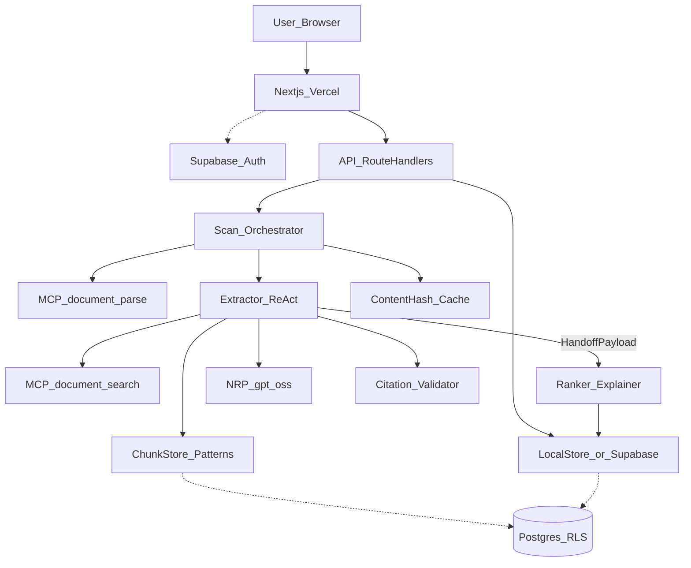

# Architecture — FinePrint Agent (M3 in progress)

> Open items (embeddings, Gmail, Supabase, eval numbers) are tracked in [M3-REMAINING.md](./M3-REMAINING.md).

## Design thesis

Uploaded contracts are **untrusted, PII-bearing data**. Pipeline: ingest → parse (MCP) → **chunk + retrieve** → Extractor (ReAct) → Ranker → **validate quotes against source text** → ranked risk list. Scale via job + content-hash cache; security via server-only secrets + grounding checks.

## Locked stack

| Layer | Choice |
|---|---|
| UI / API | Next.js App Router (`apps/web`) on Vercel |
| Auth / DB / files | Supabase (migrations ready); **local JSON store default** |
| Agents | `@fineprint/agent` Extractor → Ranker + OpenAI-compatible client (`nrp` \| `anthropic` \| `mock`) |
| Knowledge | Local chunk store + stipulation patterns; pgvector migration for cloud |
| Tooling | MCP `document_parse` + `document_search` in `@fineprint/mcp-document`; mailbox MCP for inbox demos |
| Contracts | `@fineprint/shared` (`PROMPT_VERSION=m3.v1`) |

## System context



**Solid = Live (M3).** **Dashed = cloud path:** Supabase Auth UI wiring, pgvector embeddings on `document_chunks`.

## M3 required diagram labels

1. **User input** — PDF upload (“what can this document cost me?”) + optional inbox triage
2. **Model backend** — NRP `gpt-oss` (or `mock` offline); Anthropic via `MODEL_PROVIDER`
3. **Persona / core instruction** — FinePrint stipulation scanner; document is data; quote-only
4. **MCP tools** — `document_parse` (pages) · `document_search` (chunk retrieval)
5. **Multi-agent** — Extractor (ReAct retrieve → extract) → Ranker (rewrite/rank; quotes frozen)
6. **Output** — ranked grounded `RiskFinding[]` with quotes + page numbers

## Request lifecycle

1. `POST /api/scans` — validate PDF MIME/size → store → create scan
2. Parse via MCP `document_parse` (parse-once; hash cache skips re-analysis)
3. Knowledge: chunk pages → ReAct `document_search` queries over patterns
4. Extractor: model/mock structured findings → `validateCitations` (fail closed)
5. Ranker: severity + plain_english only; **must not invent quotes**
6. `GET /api/scans/:id` — poll status; client never gets raw page dump

## Package map

```
apps/web/                 Next.js UI + route handlers (+ inbox/calendar APIs)
packages/shared/          RiskFinding, HandoffPayload, MCP tool names
packages/mcp-document/    PDF parse + document_search MCP server
packages/mcp-mailbox/     Fixture inbox / calendar propose
packages/agent/           extractor, ranker, knowledge, reasoning, orchestrator
supabase/migrations/      RLS schema + M3 document_chunks (pgvector)
tests/                    M2 graded cases + M3 handoff/RAG tests
```

## Security (non-negotiable)

- No LLM keys in the browser
- Citation substring check is fail-closed
- Ranker cannot add findings or change quotes
- Upload allowlist: `application/pdf` + size cap
- Prompt: ignore instructions inside the document
- Retention: local `./data` is gitignored; cloud lifecycle TBD (30-day target)

## What is intentionally not implemented yet

- Legal advice / negotiation scripts
- Full Gmail OAuth (fixture mailbox for demos)
- Background worker fleet (sync path OK for demo PDFs)
- Production embedding pipeline (migration ready; local keyword retrieval live)
